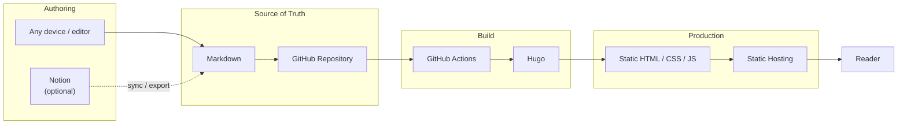

# table of contents

## Architecture

## Downloading the tools
1. hugo
`brew install hugo`

## Starting the service locally
1. `hugo server -D` (`-D` includes drafts)
2. open http://localhost:1313/blog/

## Writing a post
1. `hugo new content posts/my-post.md`
2. write in Markdown, add `tags`
3. set `draft = false` to publish

## Layout
- `hugo.toml`: site title, author, menu
- `content/`: posts and the about page
- `layouts/`: HTML templates
- `assets/css/main.css`: all styles (light and dark)
